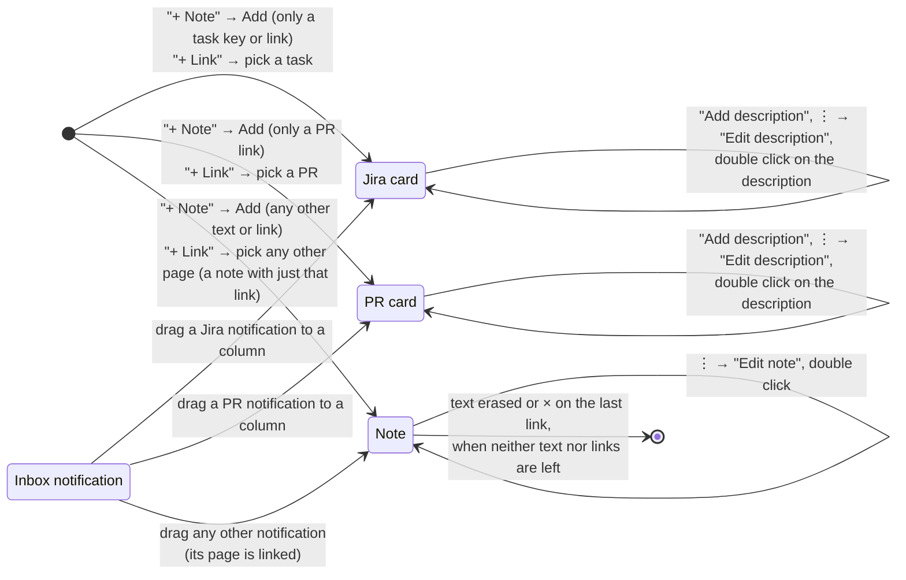

# Board cards – states and transitions

What a board card can be and which button does what to it. The rendered picture is [board-states.svg](board-states.svg); this file is its source.

A card has three parts, each optional:

- its own Jira task or pull request – shown in the card header with the status;
- text – a note's text, or the description of a Jira or PR card;
- links – Jira tasks and pages (a linked PR is a page), in the order they were linked.

The kind of a card is set when it is created and never changes. Button names are the English UI texts.

## Rules behind the arrows

- ⋮ → "Remove from the board" removes a card of any kind; it is left out of the picture to keep it readable. So are "Add link", × on a link and "Deadline…" – every card has them, and they never change its kind.
- Editing text only changes the text. An empty description is just no description; a Jira or PR card stays.
- A description is shown on top of a Jira or PR card, above the task summary or PR title. A click on it doesn't open the task or PR – a double click edits it.
- A note whose text is nothing but a link – typed in "+ Note" or left after editing – keeps it as a link, not as text: a note without text with that link (a task link or key becomes a linked task). A link that is already on the note isn't added twice. In "+ Note" a task or PR link still makes its card.
- A note goes when nothing is left of it: no text and no links. The deadline doesn't keep an empty note.
- "+ Note" makes a Jira or PR card only when the text is nothing but a task key or link, or a PR link. A task or PR that is already a card on the board is never made into a second card: "+ Note" and Inbox flash the existing card instead, "+ Link" shows it as "on the board" and doesn't let you pick it.
- "+ Link" is the same dialog as ⋮ → "Add link", only the picked link becomes a new card in the column; on an empty box it lists my Jira tasks first.
- A card never links itself: a Jira card doesn't link its own task, a PR card – its own pull request, and "Add link" doesn't offer them.
- Cards are dragged between columns in any state; no arrow changes the column.

## Boards saved by earlier versions

The board is migrated once, when the page opens (`migrateBoard()` in `board.js`); an imported file goes through the same migration:

- tasks and pages stored as two lists become one list of links, tasks first;
- a note's text moves from `title` to `text`;
- a note linked to exactly one task, not yet a card on the board, becomes that Jira card with the note text as its description – that is how earlier versions stored a description;
- a note made from a pull request before PR cards existed becomes the PR card.
