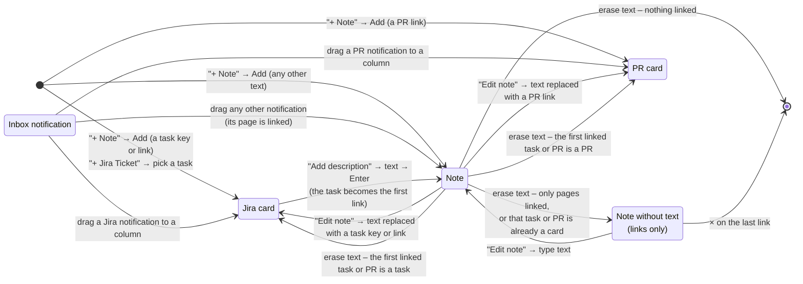

# Board cards – states and transitions

What a board card can be and which button turns it into what. The rendered picture is [board-states.svg](board-states.svg); this file is its source.

Button names are the English UI texts. "Erase text" means opening the note text ("Edit note" in the ⋮ menu, or a double click), clearing it and pressing Enter or clicking outside.

## Rules behind the arrows

- ⋮ → "Remove from the board" removes a card in any state; it is left out of the picture to keep it readable.
- Every card – a note, a Jira card or a PR card – has one list of links: Jira tasks and pages (a linked PR is a page), in the order they were linked. "Add link" in the ⋮ menu adds to it, × on a link removes from it.
- A conversion keeps the card's links and deadline. The new card never links itself: a Jira card drops the link to its own task, a PR card – to its own pull request.
- A task or PR that is already a card on the board is never made into a second card. "+ Note" and Inbox show (flash) the existing card instead; a conversion just doesn't happen.
- "Add description" then Esc, or an empty description, leaves the Jira card as it was.
- A note lives while it has text or links. The deadline doesn't keep an empty note.
- No arrow changes the column: cards are dragged between columns in any state.
